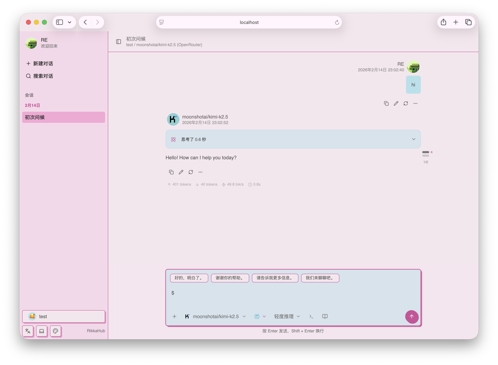

  
  <h1>o-rikkahub</h1>

A native Android LLM chat client that supports switching between different providers for
conversations 🤖💬

Click to join our Discord server 👉 [【RikkaHub】](https://discord.gg/9weBqxe5c4)

[简体中文](README_ZH_CN.md) | [繁體中文](README_ZH_TW.md) | English

  
  

## 🧩 Changes

This project is based on RikkaHub **2.5.6**. It ports the **3.1.0** feature set back onto it while
keeping the classic icons and UI style of the 2.5.6 era — old look, new capabilities.

### Ported from 3.1.0

- Media generation (the `mediagen` module: image and video generation)
- Conversation refactor (agent layer, ConversationSession, ChatService alignment)
- Checkpoint compression
- File-based memory (foreground service and memory UI included)
- Usage statistics page
- DeepSeek search
- New Markdown rendering pipeline
- Message layer alignment (branching, attachments, actions, and more)

### Added by this fork

- AI translation: brand new UI, translation history, persistent target language
- Split sidebar entries for media creation and AI translation
- Local tool `create_image`: the model can generate images that appear directly in the chat, with
  reference image support (images generated earlier in the conversation or images you sent)
- Zhipu media provider (CogView / CogVideoX)
- Real-time blurred chat top bar (independent toggle; upper half blurred with a bottom-half gradient,
  off by default so the original look is preserved)
- Enlarged generated images (half screen width, aspect-ratio aware)
- New settings icon style and grouped preference sections
- Automatic update check removed

## ✨ Development

> [!IMPORTANT]
> This project is developed with vibe coding, powered by DeepSeek V4.1 1017 and Mimo V2.6 Pro.

This project is developed using [Android Studio](https://developer.android.com/studio).

Technology stack documentation:

- [Kotlin](https://kotlinlang.org/) (Development language)
- [Koin](https://insert-koin.io/) (Dependency Injection)
- [Jetpack Compose](https://developer.android.com/jetpack/compose) (UI framework)
- [DataStore](https://developer.android.com/topic/libraries/architecture/datastore) (Preference data
  storage)
- [Room](https://developer.android.com/training/data-storage/room) (Database)
- [Coil](https://coil-kt.github.io/coil/) (Image loading)
- [Material You](https://m3.material.io/) (UI design)
- [Navigation 3](https://developer.android.com/guide/navigation/navigation-3) (Navigation)
- [Okhttp](https://square.github.io/okhttp/) (HTTP client)
- [kotlinx.serialization](https://github.com/Kotlin/kotlinx.serialization) (JSON serialization)

> [!TIP]
> You need a `google-services.json` file at `app` folder to build the app.

## 💰 Donate

The donation links below belong to the original author of RikkaHub (reovo /
[rikkahub](https://github.com/rikkahub/rikkahub)), not to this fork.

* [Patreon](https://patreon.com/rikkahub)
* [爱发电](https://afdian.com/a/reovo)

## 📄 License

This project is licensed under the [GNU Affero General Public License v3.0](LICENSE) (AGPL-3.0).
